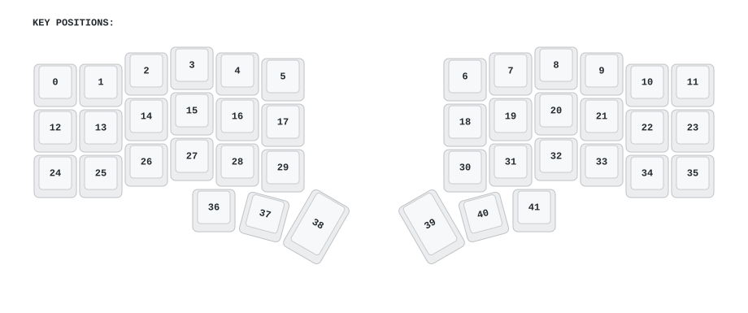

# Corne Min ZMK Firmware

Firmware for the [Mechboards Corne Min](https://mechboards.co.uk/products/corne-min), configured as a normal two-half wireless split:

- left half: central, USB/Bluetooth, ZMK Studio
- right half: Bluetooth peripheral
- no dongle, display, encoder, joystick, pointing device, or RGB underglow
- the board's built-in status LED remains enabled through `rgbled_adapter`

The layout is ported from `/Users/david/Projects/zmk-new_corne`. Corne Min has 42 keys rather than the Eyelash Corne's 48, so its six extra center hardware keys and all unavailable hardware controls are intentionally omitted. Every supported shared physical key keeps the same binding.

## Key positions



Positions are numbered `0`–`41`: three rows of 12 keys, then six thumb keys.

## Keymap



| Index | Layer | Purpose |
| ---: | --- | --- |
| 0 | BASE | QWERTY, plain home row |
| 1 | HRM | Home-row modifiers (off at power-on) |
| 2 | NUMBER | Number row; symbols via Shift |
| 3 | FN | Function keys, media, brightness, and Bluetooth profiles |
| 4 | MOUSELESS | Keyboard-driven shortcuts and navigation |
| 5 | NAV | Arrows, Home/End, Page Up/Down on the right; a numpad (`1`–`0`, and `` ` ``) on the left |

Home-row modifiers are off at power-on. To turn them on or off, hold the FN thumb key (position `39`) and tap the `A` key position. The status LED on the left half blinks yellow once when they turn on and magenta once when they turn off. They turn off again after a restart or a wake from sleep.

### Thumb keys

| Position | Tap | Hold |
| ---: | --- | --- |
| 36 | Left Option | — |
| 37 | Left Command | — |
| 38 | Space | — |
| 39 | Enter | FN |
| 40 | Backspace | NAV |
| 41 | Toggle MOUSELESS + Right Option | NUMBER |

The Backspace/NAV key uses `quick-tap-ms = <250>` so a quick second press can be held to repeat Backspace.

## Bootloader chords

Hold both keys for 750 ms to put only that half into UF2 bootloader mode:

- left half: positions `0` + `38`
- right half: positions `11` + `39`

Connect USB to the half you want to flash before holding its chord; the opposite half is not rebooted.

The implementation listens to locally scanned positions on each half. A normal ZMK combo is not used because reset behaviors invoked by combos always run on the central half.

## Firmware artifacts

GitHub Actions builds the matrix in [`build.yaml`](build.yaml):

| Artifact | Flash to | Notes |
| --- | --- | --- |
| `corne_min_left_with_studio.uf2` | left half | central half with ZMK Studio |
| `corne_min_right.uf2` | right half | split peripheral |
| `corne_min_settings_reset.uf2` | either half | clears settings and Bluetooth bonds; reflash normal firmware afterward |

Flash the left and right images to their matching halves. The keymap runs only on the left (central) half, so a change that touches only `config/corne_min.keymap` needs only the left image. This repository does not produce dongle firmware.

## Regenerate diagrams

Install [Keymap Drawer](https://github.com/caksoylar/keymap-drawer), then run:

```sh
keymap -c keymap_drawer.config.yaml parse -z config/corne_min.keymap -o keymap-drawer/corne_min.yaml
keymap -c keymap_drawer.config.yaml draw -j config/corne_min.json keymap-drawer/corne_min.yaml -o keymap-drawer/corne_min.svg
keymap -c keymap_drawer.config.yaml draw -j config/corne_min.json keymap-drawer/key_positions.yaml -o KEY_POSITIONS.svg
```

## Sources

- [Corne Min ZMK board module](https://github.com/MechboardsLTD/zmk-module/tree/corne-min)
- [Corne Min product page](https://mechboards.co.uk/products/corne-min)
- [ZMK documentation](https://zmk.dev/docs/)
